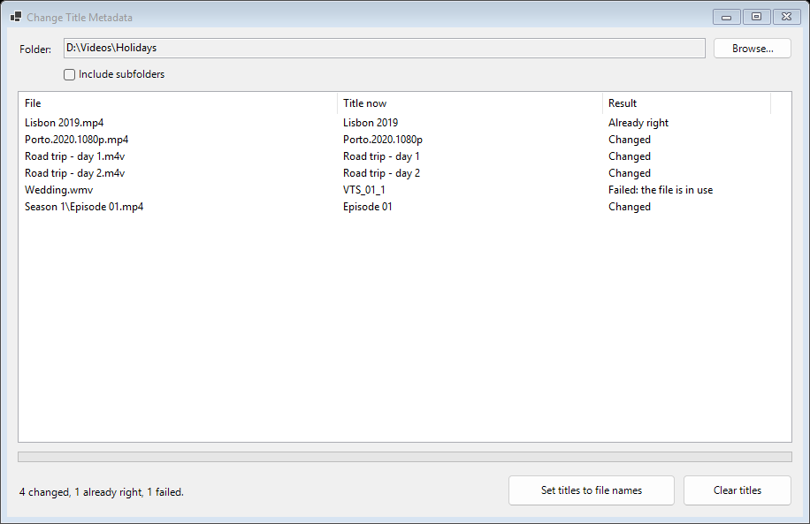

# Change Title Metadata

A small Windows program that sets the title inside your video files to the file's own name, or clears it. It fixes libraries in Plex and other media servers that show a video by the title stored in the file, which is often left over from a camera, a ripper or a download, instead of by the name you gave the file.



## Using it

1. Download `ChangeMetadata.exe` from the [latest release](https://github.com/Obsessi0n/Change-Title-Metadata/releases/latest) and run it. Nothing is installed.
2. Choose a folder. Its videos are listed with the title each one has now. Tick **Include subfolders** to go through a whole library at once.
3. Press **Set titles to file names** or **Clear titles**, and confirm.

The **Result** column says what became of each file:

- **Changed**: the title was written.
- **Already right**: the file had that title, so it was not touched and keeps its date.
- **Failed**: with the reason, such as a file in use or read-only. The other files are done all the same.

It works on `.mp4`, `.m4v` and `.wmv` files, whatever the capitals of the extension. Only the title is changed: the video, the sound and every other tag stay as they are.

## Building it

With the [.NET 10 SDK](https://dotnet.microsoft.com/download) on Windows:

```powershell
dotnet build
dotnet test
dotnet run --project src/ChangeMetadata
```

The one file a release holds is made with:

```powershell
dotnet publish src/ChangeMetadata -c Release -r win-x64 --self-contained true -p:PublishSingleFile=true -p:EnableCompressionInSingleFile=true -p:IncludeNativeLibrariesForSelfExtract=true -o publish
```

Pushing a tag such as `v2.0.0` makes GitHub build that file and attach it to a release of that name.

```text
src/ChangeMetadata/TitleTagger.cs   finds the videos and sets or clears their titles; knows nothing of the window
src/ChangeMetadata/MainForm.cs      the window
tests/ChangeMetadata.Tests/         the tests: real titles written to small video files made on the spot, and the window run off the screen
```

Tags are read and written with [TagLib#](https://github.com/mono/taglib-sharp).

## License

[MIT](LICENSE)
